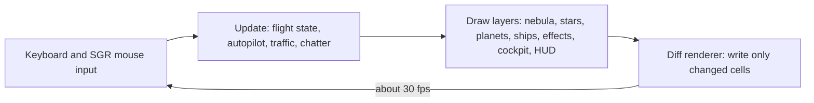
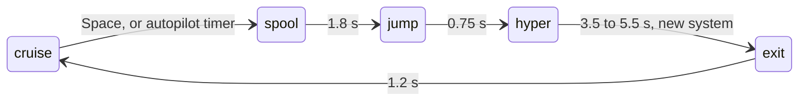

<div align="center">

<h1>drivingfalcon</h1>

<p><strong>Fly the Millennium Falcon through a quiet galaxy, right in your terminal.</strong><br>
Like <code>cmatrix</code>, but you're Han Solo and Chewie is in the co-pilot seat.</p>

<p>
<a href="#install"></a>


<a href="LICENSE"></a>

</p>

<p><strong>English</strong> · <a href="README.zh-CN.md">简体中文</a></p>

<p><a href="#features">Features</a> · <a href="#controls">Controls</a> · <a href="#install">Install</a> · <a href="#faq">FAQ</a></p>


</div>

> [!NOTE]
> **drivingfalcon is a non-commercial fan project.** It is not affiliated with, endorsed by or sponsored by Lucasfilm Ltd. or The Walt Disney Company. Star Wars, Millennium Falcon and all related names are trademarks of Lucasfilm Ltd. No art, music or text from the films is included. Every ship and planet is drawn with characters in code.

<br>

<table>
<tr>
<td width="25%" valign="top"><strong>No score, no game over</strong><br>Nothing to win or lose. Hail ships, shoot rocks, or just watch.</td>
<td width="25%" valign="top"><strong>She flies herself</strong><br>Hands off for 25 s and the autopilot takes over, turning slowly and jumping on its own.</td>
<td width="25%" valign="top"><strong>A lived-in galaxy</strong><br>10 star systems, 12 kinds of traffic, radio chatter and a flight log.</td>
<td width="25%" valign="top"><strong>One file, stdlib only</strong><br>A single Python script. No pip packages, about 1,400 lines.</td>
</tr>
</table>

## Features

<table>
<tr>
<td width="50%" valign="top">

<p><strong>Planets that turn.</strong> Each system has its own nebula and lit, rotating planets. Half-block characters double the vertical resolution, so planets look round.</p>
</td>
<td width="50%" valign="top">

<p><strong>Day and night.</strong> Light comes from the system's sun. Coruscant's city lights switch on as its surface turns into the dark.</p>
</td>
</tr>
<tr>
<td width="50%" valign="top">

<p><strong>Hail anyone.</strong> Hover a ship and the reticle turns green. Click to hail it. Rebel fighters may form up on your wing for a while.</p>
</td>
<td width="50%" valign="top">

<p><strong>Space whales.</strong> In the Lothal system, purrgil drift past slowly and sing. Your flight log records each new kind of ship you spot.</p>
</td>
</tr>
<tr>
<td width="50%" valign="top">

<p><strong>Punch it.</strong> Press <kbd>Space</kbd>: the hyperdrive spools up, stars stretch into streaks, and you arrive somewhere new.</p>
</td>
<td width="50%" valign="top">

<p><strong>Zen mode.</strong> Press <kbd>z</kbd> to hide the HUD. She cruises, burns to high speed every 12–22 s and jumps to a new system every 25–50 s.</p>
</td>
</tr>
</table>

<details>
<summary><strong>More screenshots: flight log and in-game help</strong></summary>

<br>


</details>

### Who it's for

- **A second-monitor screensaver.** Start it with `--zen` and let it wander for hours.
- **A two-minute break.** Hail a Star Destroyer, do a barrel roll, jump, close it.
- **A terminal party trick.** A demo for your shell setup, like `cmatrix` or `sl`.

## Controls

| Input | Action |
|---|---|
| Mouse move | Look around. Push to the screen edge to steer |
| Left click | On a ship: hail it. On empty space: fire the cannons |
| Right click | Fire the cannons |
| Scroll wheel, <kbd>+</kbd> <kbd>-</kbd> | Throttle |
| <kbd>←</kbd> <kbd>↑</kbd> <kbd>↓</kbd> <kbd>→</kbd> | Steer |
| <kbd>Space</kbd> | Jump to lightspeed |
| <kbd>h</kbd> | Hail the nearest ship |
| <kbd>c</kbd> | Talk to Chewie |
| <kbd>b</kbd> | Barrel roll |
| <kbd>f</kbd> | Fire at the reticle (or straight ahead) |
| <kbd>a</kbd> | Autopilot on / off |
| <kbd>z</kbd> | Zen mode: hide the HUD, she flies herself |
| <kbd>v</kbd> | Show / hide the cockpit frame |
| <kbd>j</kbd> | Flight log |
| <kbd>?</kbd> | Help |
| <kbd>q</kbd> | Quit |

Shots never destroy anyone. Friendly pilots complain, TIE fighters flee, capital ships don't notice and asteroids break apart.

## How it works



Each frame is drawn into an in-memory grid of characters and 24-bit colours. Only cells that changed since the last frame are written to the terminal, so there is no flicker. Every jump runs through the same state machine:



<details>
<summary>Rendering details</summary>

<br>

- **Planets** are shaded per sub-pixel from a smooth longitude/latitude texture, so they rotate without flicker. Results are cached and refreshed twice a second.
- **Ships** are ASCII sprites at three depths (dot, small, large). Ships crossing the screen use side views, mirrored for direction.
- **The nebula** is generated once per system and shifts with your view; during a barrel roll it rotates with the stars.
- **The terminal** is always restored on exit, including <kbd>Ctrl</kbd>+<kbd>C</kbd>, `kill` and crashes.

</details>

## Install

| Requirement | Notes |
|---|---|
| macOS or Linux | Uses `termios`, so Windows needs WSL |
| Python 3.8+ | Tested on 3.8, 3.9 (macOS built-in), 3.11, 3.12 and 3.15 |
| Terminal with 24-bit colour and mouse reporting | iTerm2, WezTerm, Kitty, Ghostty, Alacritty, GNOME Terminal |
| Window at least 44 × 14 | 120 × 36 or larger looks best |

With [Homebrew](https://brew.sh):

```bash
brew install Olivia295/tap/drivingfalcon
```

Check that it worked:

```bash
drivingfalcon --version
```

```text
drivingfalcon 1.0.0
```

Take off:

```bash
drivingfalcon
```

Or go straight into zen mode with the autopilot on:

```bash
drivingfalcon --zen
```

<details>
<summary>Without Homebrew (any system with Python 3.8+)</summary>

<br>

```bash
curl -fsSLO https://raw.githubusercontent.com/Olivia295/drivingfalcon/main/drivingfalcon.py
```

```bash
python3 drivingfalcon.py
```

</details>

### Options

| Flag | Effect |
|---|---|
| `--zen` | Start in zen mode with the autopilot on |
| `--no-cockpit` | Hide the cockpit frame |
| `--stats` | Print the average frame time when you quit |
| `--version` | Print the version and exit |
| `-h`, `--help` | Show usage |

<details>
<summary><strong>Local development</strong></summary>

<br>

Clone and run straight from the source. There is no build step.

```bash
git clone https://github.com/Olivia295/drivingfalcon.git
```

```bash
cd drivingfalcon
```

```bash
python3 drivingfalcon.py
```

The README screenshots and GIF are rendered from real game frames by `tools/capture.py`. It runs the game headless and needs [Pillow](https://pypi.org/project/pillow/) and `ffmpeg`:

```bash
python3 tools/capture.py
```

```text
drivingfalcon/
├── drivingfalcon.py      # the whole game
├── tools/capture.py      # renders docs/assets/*.png and demo.gif
├── docs/assets/          # README images
├── README.md
├── README.zh-CN.md
└── LICENSE
```

</details>

## FAQ

<details>
<summary>The colours look wrong or blotchy</summary>

<br>

Your terminal probably doesn't support 24-bit "truecolor". Older versions of macOS Terminal.app are one example. Try iTerm2, WezTerm, Kitty or Ghostty.

</details>

<details>
<summary>Planets and lines are misaligned or doubled</summary>

<br>

Your terminal draws "ambiguous-width" characters such as `▀ │ ·` two cells wide. This is common with CJK locales. In iTerm2, open Settings → Profiles → Text and turn off **Ambiguous characters are double-width**.

</details>

<details>
<summary>Clicking does nothing</summary>

<br>

drivingfalcon uses SGR mouse reporting. Most modern terminals support it. Inside `tmux`, enable `set -g mouse on`. Every action also has a key: <kbd>h</kbd> hails, <kbd>f</kbd> fires.

</details>

<details>
<summary>It only says "make the terminal a little bigger"</summary>

<br>

Your window is smaller than 44 × 14 cells. Enlarge it or reduce the font size. The game picks up the new size immediately.

</details>

<details>
<summary>My terminal looks odd after quitting</summary>

<br>

The game restores the terminal on every normal exit. If something was force-killed with `kill -9`, run `reset`.

</details>

## License and credits

The code is released under the [MIT License](LICENSE). It is a **non-commercial fan project**; Star Wars names belong to Lucasfilm Ltd.

Inspired by [cmatrix](https://github.com/abishekvashok/cmatrix). Built for anyone who has ever wanted to sit in that cockpit.
