<div align="center">

<h1>drivingfalcon</h1>

<p><strong>在终端里驾驶千年隼，穿越一个安静的银河。</strong><br>
像 <code>cmatrix</code> 一样的终端小玩具，只是这次你是 Han Solo，Chewie 坐在副驾驶。</p>

<p>
<a href="#安装"></a>


<a href="LICENSE"></a>

</p>

<p><a href="README.md">English</a> · <strong>简体中文</strong></p>

<p><a href="#功能">功能</a> · <a href="#操作">操作</a> · <a href="#安装">安装</a> · <a href="#常见问题">常见问题</a></p>

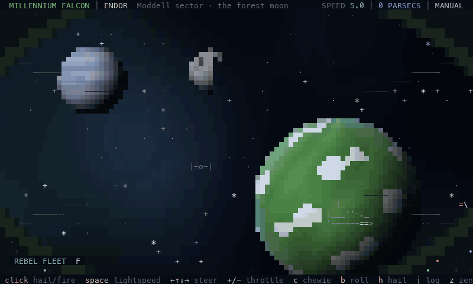

</div>

> [!NOTE]
> **drivingfalcon 是非商业同人作品（non-commercial fan project）。** 它与 Lucasfilm Ltd. 或 The Walt Disney Company 没有任何关联，也未获得其认可或赞助。Star Wars、Millennium Falcon 及相关名称是 Lucasfilm Ltd. 的商标。项目不包含电影中的任何美术、音乐或台词素材，所有飞船和行星都是在代码里用字符画出来的。

<br>

<table>
<tr>
<td width="25%" valign="top"><strong>没有分数，没有 Game Over</strong><br>没什么可赢也没什么可输。呼叫飞船、打打石头，或者只是看着。</td>
<td width="25%" valign="top"><strong>她会自己飞</strong><br>25 秒不操作，自动驾驶就会接管：缓缓转向，到点自己跳光速。</td>
<td width="25%" valign="top"><strong>有人气的银河</strong><br>10 个星系、12 种来往飞船、无线电闲聊，还有一本航行日志。</td>
<td width="25%" valign="top"><strong>单文件，只用标准库</strong><br>一个 Python 脚本，不需要 pip 安装任何包，约 1400 行。</td>
</tr>
</table>

## 功能

<table>
<tr>
<td width="50%" valign="top">
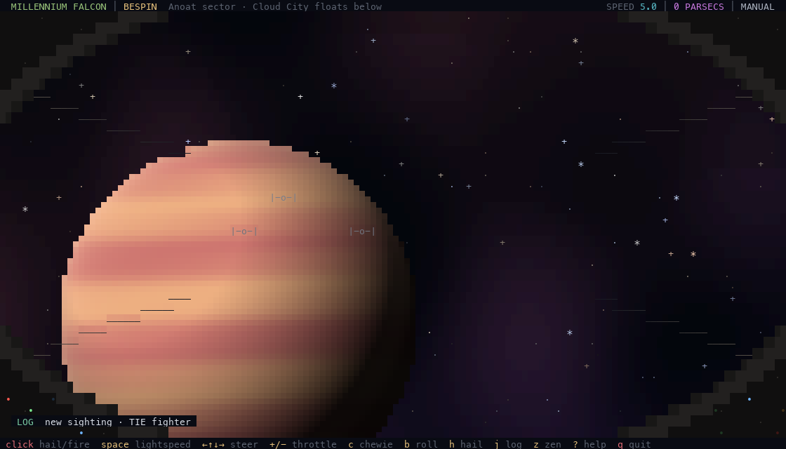
<p><strong>会自转的行星。</strong>每个星系有自己的星云，行星有光照、会自转。用半格字符把竖向分辨率翻倍，所以行星看起来是圆的。</p>
</td>
<td width="50%" valign="top">
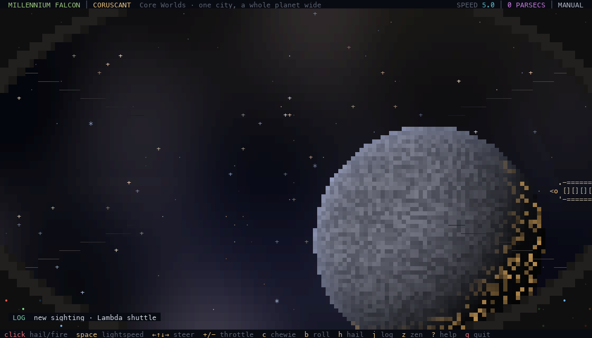
<p><strong>昼夜交替。</strong>光线来自所在星系的恒星。Coruscant 的城市转进夜面时，万家灯火会亮起来。</p>
</td>
</tr>
<tr>
<td width="50%" valign="top">
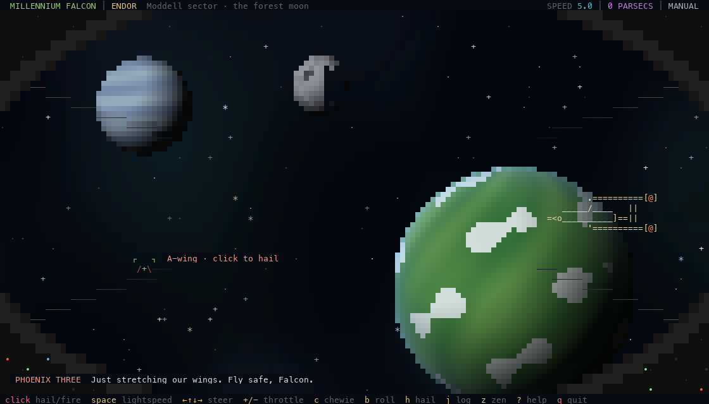
<p><strong>谁都可以呼叫。</strong>鼠标移到飞船上，准星会变绿，点击就能呼叫它。义军战机有时还会加入你的编队，陪你飞一程。</p>
</td>
<td width="50%" valign="top">
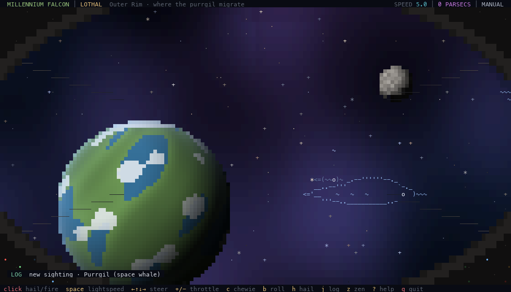
<p><strong>太空鲸。</strong>在 Lothal 星系，purrgil 会慢慢游过并唱歌。航行日志会记下你第一次见到的每一种飞船。</p>
</td>
</tr>
<tr>
<td width="50%" valign="top">
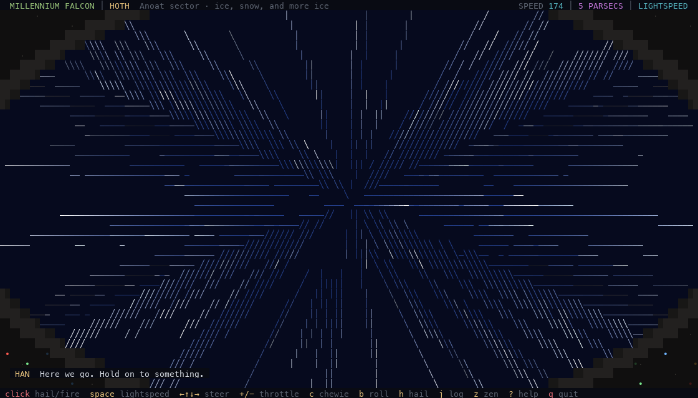
<p><strong>跳光速。</strong>按 <kbd>Space</kbd>：超空间引擎启动，星星拉成光带，然后抵达一个新的星系。</p>
</td>
<td width="50%" valign="top">
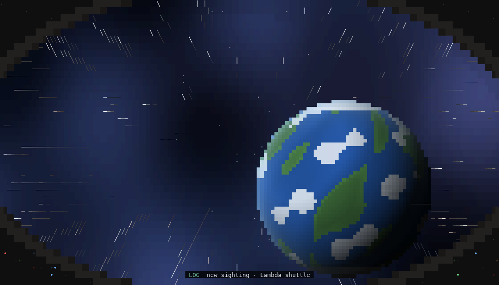
<p><strong>禅模式。</strong>按 <kbd>z</kbd> 隐藏 HUD。她会自己巡航，每 12–22 秒加速冲刺一次，每 25–50 秒跳到一个新星系。</p>
</td>
</tr>
</table>

<details>
<summary><strong>更多截图：航行日志和游戏内帮助</strong></summary>

<br>

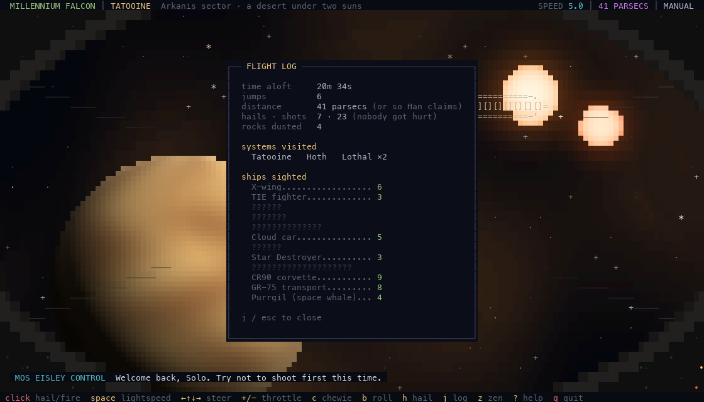

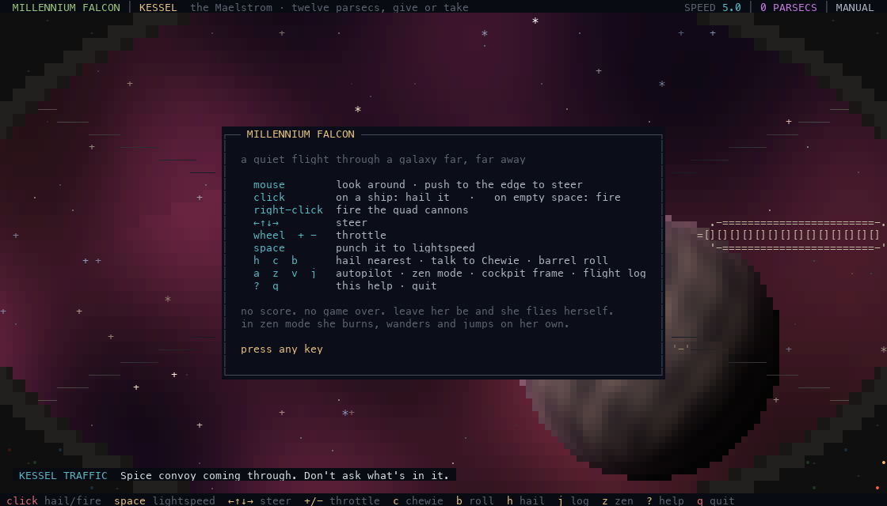

</details>

### 适合谁

- **第二块屏幕的屏保。** 用 `--zen` 启动，让她自己飞上几个小时。
- **两分钟的小憩。** 呼叫一艘歼星舰、翻个滚、跳个光速，然后关掉。
- **终端里的小彩蛋。** 像 `cmatrix` 或 `sl` 一样，给朋友展示你的终端。

## 操作

| 输入 | 作用 |
|---|---|
| 移动鼠标 | 环顾四周，推到屏幕边缘可以转向 |
| 左键 | 点在飞船上：呼叫它；点在空处：开炮 |
| 右键 | 开炮 |
| 滚轮、<kbd>+</kbd> <kbd>-</kbd> | 油门 |
| <kbd>←</kbd> <kbd>↑</kbd> <kbd>↓</kbd> <kbd>→</kbd> | 转向 |
| <kbd>Space</kbd> | 跳光速 |
| <kbd>h</kbd> | 呼叫最近的飞船 |
| <kbd>c</kbd> | 和 Chewie 聊天 |
| <kbd>b</kbd> | 桶滚翻 |
| <kbd>f</kbd> | 朝准星（或正前方）开炮 |
| <kbd>a</kbd> | 开关自动驾驶 |
| <kbd>z</kbd> | 禅模式：隐藏 HUD，交给她自己飞 |
| <kbd>v</kbd> | 显示或隐藏驾驶舱框架 |
| <kbd>j</kbd> | 航行日志 |
| <kbd>?</kbd> | 帮助 |
| <kbd>q</kbd> | 退出 |

炮火不会摧毁任何东西：友军会抱怨，TIE 战机会被吓跑，主力舰根本不在意，小行星会碎成两半。

## 工作原理

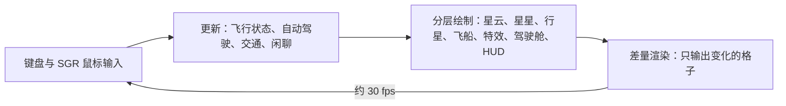

每一帧先画进内存里的字符 + 24 位色网格，只有和上一帧不同的格子才会写到终端，所以画面不闪。每次跳光速都走同一个状态机：

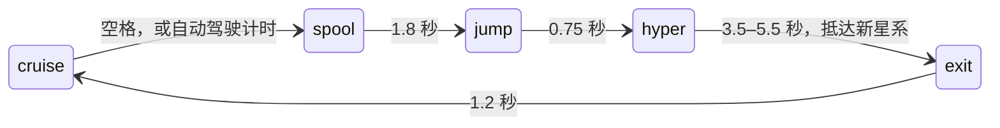

<details>
<summary>渲染细节</summary>

<br>

- **行星**按子像素着色，纹理是平滑的经纬度函数，所以自转时不闪。结果会缓存，每秒刷新两次。
- **飞船**是三档远近的 ASCII 图案（光点、小、大）。横穿画面的飞船用侧视图，按方向镜像。
- **星云**每个星系生成一次，随视角平移；桶滚翻时会和星星一起旋转。
- **终端**在退出时一定会被恢复，包括 <kbd>Ctrl</kbd>+<kbd>C</kbd>、`kill` 和程序崩溃。

</details>

## 安装

| 要求 | 说明 |
|---|---|
| macOS 或 Linux | 依赖 `termios`，Windows 需要用 WSL |
| Python 3.8+ | 在 3.8、3.9（macOS 自带）、3.11、3.12、3.15 上测试过 |
| 支持 24 位真彩色和鼠标上报的终端 | iTerm2、WezTerm、Kitty、Ghostty、Alacritty、GNOME Terminal |
| 窗口至少 44 × 14 | 120 × 36 或更大效果最好 |

用 [Homebrew](https://brew.sh) 安装：

```bash
brew install Olivia295/tap/drivingfalcon
```

确认安装成功：

```bash
drivingfalcon --version
```

```text
drivingfalcon 1.0.0
```

起飞：

```bash
drivingfalcon
```

或者直接进入禅模式，打开自动驾驶：

```bash
drivingfalcon --zen
```

<details>
<summary>不用 Homebrew（任何装有 Python 3.8+ 的系统）</summary>

<br>

```bash
curl -fsSLO https://raw.githubusercontent.com/Olivia295/drivingfalcon/main/drivingfalcon.py
```

```bash
python3 drivingfalcon.py
```

</details>

### 命令行参数

| 参数 | 作用 |
|---|---|
| `--zen` | 以禅模式启动，并打开自动驾驶 |
| `--no-cockpit` | 隐藏驾驶舱框架 |
| `--stats` | 退出时打印平均每帧耗时 |
| `--version` | 打印版本号后退出 |
| `-h`、`--help` | 显示用法 |

<details>
<summary><strong>本地开发</strong></summary>

<br>

克隆下来直接运行源码，不需要构建。

```bash
git clone https://github.com/Olivia295/drivingfalcon.git
```

```bash
cd drivingfalcon
```

```bash
python3 drivingfalcon.py
```

README 里的截图和 GIF 都由 `tools/capture.py` 从真实的游戏画面渲染而来。它在后台无界面运行游戏，需要 [Pillow](https://pypi.org/project/pillow/) 和 `ffmpeg`：

```bash
python3 tools/capture.py
```

```text
drivingfalcon/
├── drivingfalcon.py      # 整个游戏
├── tools/capture.py      # 渲染 docs/assets/*.png 和 demo.gif
├── docs/assets/          # README 图片
├── README.md
├── README.zh-CN.md
└── LICENSE
```

</details>

## 常见问题

<details>
<summary>颜色不对，或者一块一块的</summary>

<br>

你的终端可能不支持 24 位真彩色，比如旧版 macOS 自带的 Terminal.app。可以换用 iTerm2、WezTerm、Kitty 或 Ghostty。

</details>

<details>
<summary>行星和线条错位、重影</summary>

<br>

你的终端把 `▀ │ ·` 这类"宽度不明确"的字符画成了两格宽，在中日韩语言环境下很常见。iTerm2 里打开 Settings → Profiles → Text，关掉 **Ambiguous characters are double-width**。

</details>

<details>
<summary>点击没反应</summary>

<br>

drivingfalcon 使用 SGR 鼠标上报，大多数现代终端都支持。在 `tmux` 里需要开启 `set -g mouse on`。另外每个操作都有对应按键：<kbd>h</kbd> 呼叫，<kbd>f</kbd> 开炮。

</details>

<details>
<summary>屏幕上只显示 "make the terminal a little bigger"</summary>

<br>

窗口小于 44 × 14 个字符。把窗口拉大或调小字号，游戏会立刻适应新尺寸。

</details>

<details>
<summary>退出后终端显示怪怪的</summary>

<br>

正常退出时游戏都会恢复终端。如果进程被 `kill -9` 强行杀掉，运行 `reset` 即可。

</details>

## 许可与致谢

代码以 [MIT 许可证](LICENSE) 发布。本项目是**非商业同人作品**，Star Wars 相关名称归 Lucasfilm Ltd. 所有。

灵感来自 [cmatrix](https://github.com/abishekvashok/cmatrix)。献给每一个想坐进那个驾驶舱的人。
